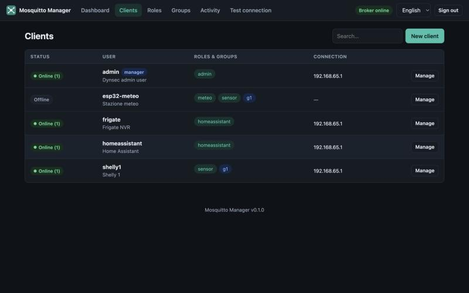

# Mosquitto Manager

Una piccola interfaccia web, da installare in casa, per gestire un broker [Eclipse Mosquitto](https://mosquitto.org)
**già esistente**: utenti, password, ruoli e ACL, chi è collegato, e perché un dispositivo non riesce a entrare.

*English: [README.md](README.md)*


<p>
  
  
</p>

## Cosa fa

- **Utenti**: crea, disabilita, elimina, cambia password (con generatore), lega un utente a un client id.
- **Ruoli, gruppi e ACL**: concedi un topic con un clic ("leggere e scrivere su `shellies/#`") senza scrivere a mano
  le quattro regole di Dynamic Security; consenti/nega; accesso predefinito.
- **Chi è collegato**: connessioni attive per utente, con indirizzo, client id, protocollo e keepalive.
- **Login falliti**: quale client id e quale indirizzo vengono rifiutati, e quante volte.
- **Prova il login**: apre una breve connessione con nome utente e password, come un dispositivo, e mostra la
  risposta del broker in parole semplici.
- **Mappa delle connessioni**: il broker al centro, intorno ogni indirizzo con i client collegati da lì, e in
  rosso le sorgenti dei login rifiutati. Puoi dare un nome a un indirizzo ("Server di casa").
- **Sensori per Home Assistant** (facoltativo): stato del broker, login falliti e un sensore di connessione per
  ogni utente, tramite MQTT discovery. Vedi [docs/HOME_ASSISTANT.md](docs/HOME_ASSISTANT.md) (in inglese).
- **Registro attività**: connessioni, disconnessioni, login rifiutati e ogni modifica fatta dal canale di controllo
  del broker (le password non vengono mai mostrate).
- **Dashboard**: versione e uptime del broker, client, sottoscrizioni, messaggi al minuto, grafici dell'ultima ora.
- **Sicuro per costruzione**: rifiuta le azioni che lo escluderebbero dal broker.
- Interfaccia in italiano e inglese, tema chiaro e scuro, usabile da telefono.

**Non** ha bisogno dei file del broker, di Docker né dell'host: è solo un client MQTT (parla col plugin Dynamic
Security e legge `$SYS`). Può girare ovunque raggiunga la porta MQTT del broker.

## Requisiti

- Mosquitto **2.0 o successivo** con il plugin Dynamic Security (incluso nei pacchetti ufficiali e nell'immagine
  `eclipse-mosquitto`). Provato con 2.0.22 e 2.1.2.
- Consigliato **2.1 o successivo**: indica direttamente le connessioni attive per utente e permette di
  [mantenere le password già esistenti](#hai-già-utenti-in-un-password_file) passando da `password_file`.

## Installazione

**1. Abilita il plugin e il registro** in `mosquitto.conf` ([esempio completo](docs/mosquitto.conf.example)) e riavvia
il broker:

```conf
plugin /usr/lib/mosquitto_dynamic_security.so
plugin_opt_config_file /mosquitto/data/dynamic-security.json

log_dest stdout
log_dest topic
log_type error
log_type warning
log_type notice
log_type information
connection_messages true
```

**2. Crea l'account del manager.** Serve un ruolo a privilegi minimi (solo controllo Dynamic Security e `$SYS`).
Lo strumento in `tools/` scrive la configurazione e genera la password:

```bash
python3 tools/passwd_to_dynsec.py --out ./dynamic-security.json --admin mm-admin
```

Metti il file dove punta `plugin_opt_config_file` e riavvia il broker.

**3. Avvia il manager** ([esempio compose](docker-compose.example.yml)):

```bash
docker run -d --name mosquitto-manager --restart unless-stopped -p 8088:8080 \
  -e MQTT_HOST=192.168.1.10 \
  -e MQTT_USERNAME=mm-admin -e MQTT_PASSWORD='la-password-generata' \
  -e UI_PASSWORD='una-password-lunga-per-la-web-ui' \
  -v mosquitto-manager-data:/data \
  ghcr.io/hubcasale/mosquitto-manager:latest
```

Apri `http://<server>:8088`.

L'immagine non è ancora pubblicata? Costruiscila da una copia del repo: `docker build -t mosquitto-manager .` e usa quel nome.

## Hai già `password_file` e `acl_file`?

Con Mosquitto **2.1+** puoi passare a Dynamic Security **senza toccare nessun dispositivo**: le password si
importano così come sono e l'`acl_file` diventa un ruolo per utente. Verificato su 2.1.2: con una copia di una
configurazione reale (12 utenti, listener anonimo locale) ho confrontato il broker con `acl_file` e quello
convertito su 548 prove (login, accesso anonimo, e per ogni utente quali topic può leggere e scrivere):
**548 identiche**.

Da sapere prima:

1. **Con il plugin caricato, un utente deve esistere in Dynamic Security per avere accesso**, anche se il login
   passerebbe dal `password_file`. Quindi è un'*importazione*, non una convivenza.
2. Cosa viene convertito: `user X` diventa un ruolo `X` assegnato all'utente `X`; `topic read/write/readwrite`
   diventano le regole corrispondenti; le regole prima del primo `user` (client anonimi) diventano il gruppo
   `anonymous`, così un listener locale anonimo continua a funzionare. **Non** vengono convertite le regole
   `pattern` (con `%u` / `%c`): lo strumento le elenca e vanno rifatte a mano.
3. **Sottoscrizioni come prima**: con `acl_file` il broker accetta qualunque sottoscrizione e filtra alla
   consegna; Dynamic Security di norma rifiuta la sottoscrizione. Per non rompere i client che si sottoscrivono
   in modo più ampio di quanto possono leggere, lo strumento attiva "consenti di sottoscrivere" nell'accesso
   predefinito. Quando tutto funziona lo spegni da *Ruoli → Accesso predefinito* (oppure usa `--strict-subscribe`).
4. Serve **un riavvio** del broker (pochi secondi); i dispositivi si ricollegano da soli.

Passi:

```bash
# 0. fai una copia delle cartelle config e data del broker

# 1. genera la configurazione (il JSON va nella cartella data del broker)
python3 tools/passwd_to_dynsec.py --passwd /percorso/mosquitto.passwd --acl /percorso/acl.conf \
  --out /percorso/data/dynamic-security.json --admin mm-admin
```

Lo strumento stampa cosa ha importato, gli avvisi e la password generata per `mm-admin` (mostrata una sola volta:
va in `MQTT_PASSWORD`). Le voci che non sono hash `$7$` vengono elencate come *non importate*: ricreale dall'interfaccia.

Poi in `mosquitto.conf` aggiungi il plugin e il registro (vedi sopra), togli `password_file` e `acl_file`
(le impostazioni per listener come `listener_allow_anonymous` restano), riavvia, e avvia il manager.
Guida completa in inglese: [docs/MIGRATION.md](docs/MIGRATION.md). Per tornare indietro basta rimettere il vecchio
`mosquitto.conf`: né il file delle password né l'ACL vengono modificati.

## Configurazione

| Variabile | Predefinito | |
|---|---|---|
| `MQTT_HOST` | *obbligatoria* | Indirizzo del broker |
| `MQTT_PORT` | `1883` | |
| `MQTT_USERNAME`, `MQTT_PASSWORD` | *obbligatorie* | Account Dynamic Security del manager |
| `MQTT_TLS` | `false` | TLS verso il broker |
| `MQTT_CA_FILE` | CA di sistema | Certificato CA da usare |
| `UI_PASSWORD` | *obbligatoria* | Password della web UI, almeno 8 caratteri |
| `AUTH_DISABLED` | `false` | Disattiva il login. Solo dietro qualcosa che già autentica |
| `FRAME_ANCESTORS` | `'self'` | Chi può incorporare la UI in un iframe (CSP `frame-ancestors`) |
| `COOKIE_SECURE` | `false` | Metti `true` se servita in HTTPS |
| `SESSION_HOURS` | `12` | Validità del login |
| `PORT` | `8080` | Porta dentro il container |
| `HA_DISCOVERY` | `false` | Pubblica i sensori in Home Assistant |
| `HA_USER_SENSORS` | `true` | Un sensore di connessione per ogni utente |
| `HA_FAILED_THRESHOLD` | `5` | Login falliti in 10 minuti che accendono il sensore "attacco al login" |

## Sicurezza

Per cifrare MQTT (porta 8883, rinnovo del certificato senza riavvii, passaggio dei client) vedi
[docs/TLS.md](docs/TLS.md) (in inglese).

Questo strumento può cambiare chi si collega al tuo broker: trattalo come un pannello di amministrazione.

- Tienilo **in LAN o dietro VPN / reverse proxy con autenticazione e HTTPS**. Non esporlo direttamente su internet.
  Parla in HTTP semplice: termina il TLS in un proxy e imposta `COOKIE_SECURE=true`.
- La UI ha una password, cookie di sessione firmato `HttpOnly` e `SameSite=Strict`, limite ai tentativi di login
  (5 errori in 5 minuti per indirizzo) e un header anti-CSRF su ogni modifica.
- L'account del manager può modificare ogni utente e ACL: dagli una password lunga e casuale. Il manager rifiuta di
  eliminare, disabilitare, cambiare la password o togliere il ruolo al proprio account.

## Limiti

- **Dettagli delle connessioni**: client id, protocollo, keepalive e "da quando" arrivano dal registro del broker,
  quindi esistono solo per le connessioni aperte *dopo* l'avvio del manager. Con 2.1+ l'indirizzo delle connessioni
  precedenti si vede comunque; con 2.0.x non sono elencate finché il dispositivo non si ricollega.
- **Sessioni salvate**: Mosquitto elenca come connessioni anche i dispositivi con sessione persistente (clean session
  disattivato) dopo che si sono scollegati. Dopo un riavvio del broker tornano da disco senza indirizzo: il manager le
  mostra come "sessioni salvate", non come online. Durante una stessa esecuzione del broker, un client persistente
  scollegato può sembrare ancora collegato finché il broker non riparte o la sessione non scade; con
  `persistent_client_expiration` (per esempio `1d`) in `mosquitto.conf` le sessioni scadono.
- **Storico limitato**: gli ultimi ~1000 eventi, in memoria e in un piccolo file in `/data`.
- **`acl_file` convertito, con un'eccezione**: lo strumento di migrazione trasforma l'ACL in ruoli, ma le regole
  `pattern` (`%u` / `%c`) non sono esprimibili in Dynamic Security e vanno rifatte a mano.
- **Mappa: indirizzi, non dispositivi**: i client sulla stessa macchina, o dentro Docker, mostrano lo stesso
  indirizzo. Mosquitto non fornisce il traffico per client, quindi la mappa mostra chi è collegato, non quanto parla.
- **Un broker per manager**.

## Licenza

[MIT](LICENSE)
