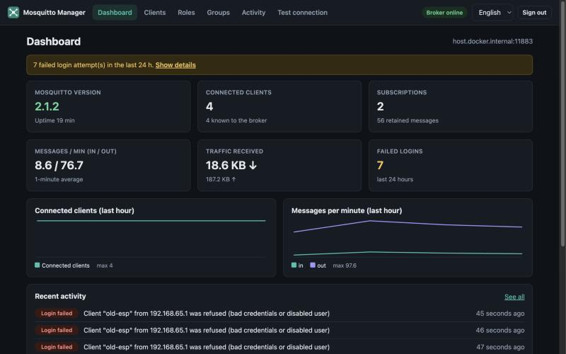
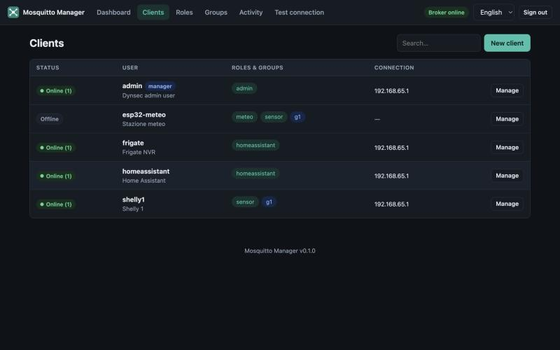
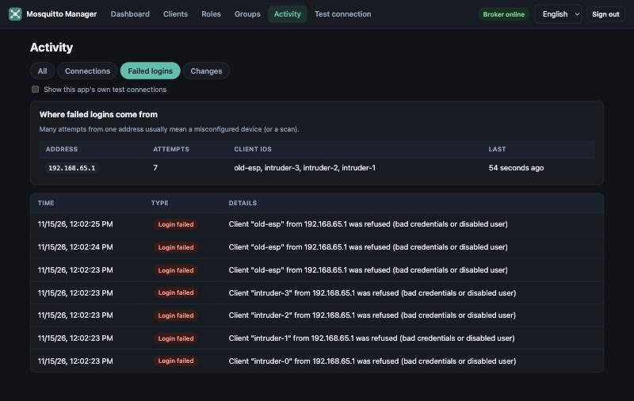

# Mosquitto Manager

A small, self-hosted web UI for an **existing** [Eclipse Mosquitto](https://mosquitto.org) broker:
manage users, passwords, roles and ACLs, see who is connected, and find out why a device cannot log in.

*Italiano: [README.it.md](README.it.md)*



<p>
  
  
</p>

## Features

- **Users**: create, disable, delete, change passwords (with a generator), bind to a client id.
- **Roles, groups and ACLs**: grant topics with one click ("read and write on `shellies/#`") instead of
  hand-writing four Dynamic Security rules; allow/deny; default access.
- **Who is connected**: live connections per user, with address, client id, protocol and keepalive.
- **Encrypted or not**: each connection is marked TLS or plain (users page, map, dashboard counter), to see who is still on port 1883 while you move clients to TLS. See [docs/TLS.md](docs/TLS.md).
- **Certificate watch**: shows when the broker's TLS certificate expires, warns well before, and can raise a Home Assistant alert. See [docs/TLS.md](docs/TLS.md).
- **Failed logins**: which client id and which address keep being refused, and how often.
- **Test a login**: open a short connection with a username/password, exactly like a device, and see the
  broker's answer in plain words.
- **Connection map**: the broker in the middle, each address around it with the clients connected from there,
  and the sources of refused logins in red. Give an address a friendly name ("Home server").
- **Home Assistant sensors** (optional): broker status, failed logins, and a connectivity sensor per user,
  through MQTT discovery. See [docs/HOME_ASSISTANT.md](docs/HOME_ASSISTANT.md).
- **Activity log**: connections, disconnections, refused logins, and every change made through the broker's
  control channel (passwords are never shown).
- **Dashboard**: broker version and uptime, clients, subscriptions, message rate, last-hour charts.
- **Safe by default**: it refuses actions that would lock itself out of the broker.
- English and Italian UI, dark and light theme, works on a phone.

It does **not** need access to the broker's files, to Docker, or to the host: it is just an MQTT client
(it talks to the broker's Dynamic Security plugin and reads `$SYS`). It can run anywhere that can reach
the broker's MQTT port.

## How it works

```
 browser ──HTTP──▶ Mosquitto Manager ──MQTT──▶ Mosquitto
                   (this project)             ├─ Dynamic Security plugin  (users, roles, ACLs)
                                              ├─ $SYS/#                   (statistics)
                                              └─ $SYS/broker/log/*        (connections, logins)
```

## Requirements

- Mosquitto **2.0 or newer** with the Dynamic Security plugin (it ships with the official packages and
  the `eclipse-mosquitto` image). Tested against 2.0.22 and 2.1.2.
- Mosquitto **2.1 or newer is recommended**: it reports live connections per user directly, and lets you
  [carry over your existing passwords](docs/MIGRATION.md) when switching from `password_file`.
  On 2.0.x everything works, but live connections are reconstructed from the log feed (see
  [Limitations](#limitations)).

## Quick start

**1. Enable the plugin and the log feed** in `mosquitto.conf`
([full example](docs/mosquitto.conf.example)), then restart the broker:

```conf
plugin /usr/lib/mosquitto_dynamic_security.so
plugin_opt_config_file /mosquitto/data/dynamic-security.json

log_dest stdout
log_dest topic
log_type error
log_type warning
log_type notice
log_type information
connection_messages true
```

**2. Create the manager's account.** It needs a least-privilege role (Dynamic Security control and `$SYS`
only). The helper in `tools/` writes the config for you, with a generated password:

```bash
python3 tools/passwd_to_dynsec.py --out ./dynamic-security.json --admin mm-admin
```

Put the file where `plugin_opt_config_file` points and restart the broker. **Already have users in a
`password_file` (and rules in an `acl_file`)?** Use `--passwd` and `--acl` to carry them over with their
current passwords and permissions, so no device needs changing: see [docs/MIGRATION.md](docs/MIGRATION.md).

**3. Run the manager** ([compose example](docker-compose.example.yml)):

```bash
docker run -d --name mosquitto-manager --restart unless-stopped -p 8088:8080 \
  -e MQTT_HOST=192.168.1.10 \
  -e MQTT_USERNAME=mm-admin -e MQTT_PASSWORD='the-generated-password' \
  -e UI_PASSWORD='a-long-password-for-the-web-ui' \
  -v mosquitto-manager-data:/data \
  ghcr.io/hubcasale/mosquitto-manager:latest
```

Open `http://<server>:8088`.

No published image yet? Build it from a checkout: `docker build -t mosquitto-manager .` and use that name instead.

## Configuration

| Variable | Default | |
|---|---|---|
| `MQTT_HOST` | *required* | Broker address |
| `MQTT_PORT` | `1883` | |
| `MQTT_USERNAME`, `MQTT_PASSWORD` | *required* | The manager's Dynamic Security account |
| `MQTT_TLS` | `false` | Use TLS to the broker (see [docs/TLS.md](docs/TLS.md) for enabling it on the broker) |
| `MQTT_CA_FILE` | system CAs | CA certificate to trust |
| `MQTT_TLS_INSECURE` | `false` | Skip hostname verification (not recommended) |
| `UI_PASSWORD` | *required* | Password for the web UI, at least 8 characters |
| `AUTH_DISABLED` | `false` | Turn off the UI login. Only behind something that already authenticates |
| `FRAME_ANCESTORS` | `'self'` | Who may embed the UI in an iframe (CSP `frame-ancestors`) |
| `COOKIE_SECURE` | `false` | Set to `true` when served over HTTPS |
| `SESSION_HOURS` | `12` | Login validity |
| `UI_SECRET` | generated | Session signing key (otherwise generated once and stored in `/data`) |
| `PORT` | `8080` | Port inside the container |
| `DATA_DIR` | `/data` | Session key and a small activity cache |
| `LOG_LEVEL` | `info` | |
| `CERT_WARN_DAYS` | `14` | Warn when the broker's TLS certificate has fewer days left |
| `CERT_CHECK` | `auto` | Where to read the certificate: `auto`, `off`, or `host:port[,host:port]` |
| `TLS_PORTS` | `8883` | Broker ports that are TLS listeners (used to mark connections encrypted) |
| `HA_DISCOVERY` | `false` | Publish sensors to Home Assistant ([details](docs/HOME_ASSISTANT.md)) |
| `HA_USER_SENSORS` | `true` | One connectivity sensor per user |
| `HA_FAILED_THRESHOLD` | `5` | Failed logins in 10 minutes that turn the "login attack" sensor on |
| `HA_DISCOVERY_PREFIX` | `homeassistant` | Home Assistant's discovery prefix |
| `HA_NODE_ID`, `HA_BASE_TOPIC` | `mosquitto_manager` | Names used in the published topics |

## Security

To encrypt MQTT itself (port 8883, certificate renewal without restarts, moving clients over) see
[docs/TLS.md](docs/TLS.md).

This tool can change who may connect to your broker, so treat it like an admin panel.

- Keep it on your **LAN or behind a VPN / authenticating reverse proxy with HTTPS**. Do not expose it to
  the internet directly. It speaks plain HTTP; terminate TLS in a proxy and set `COOKIE_SECURE=true`.
- The UI is protected by a password, with a signed `HttpOnly`, `SameSite=Strict` session cookie,
  login throttling (5 failures / 5 min per address) and a CSRF header on every change.
- Page content is built without `innerHTML` and served with a strict Content-Security-Policy.
- The manager's broker account can edit every user and ACL, so give it a long random password.
  It refuses to delete, disable, re-password or strip the role of its own account.

## Limitations

- **Live connection details.** Per-connection details (client id, protocol, keepalive, "since") come from the
  broker log, so they only exist for connections opened *after* the manager started. On Mosquitto 2.1+
  the address of earlier connections is still shown. On 2.0.x connections opened before the manager
  started are not listed until the device reconnects.
- **Saved sessions.** Mosquitto lists devices with a persistent session (clean session off) as connections
  even after they disconnect. After a broker restart they come back from disk with no address: the manager
  shows those as "saved sessions", not as online. Within one broker run, a persistent client that disconnects
  can still look connected until the broker restarts or its session expires; setting
  `persistent_client_expiration` (for example `1d`) in `mosquitto.conf` makes them expire.
- **History is small.** The last ~1000 events are kept in memory and a small file in `/data`.
- **`acl_file` is converted, with one gap.** The migration tool turns ACL files into roles, but `pattern`
  rules (`%u` / `%c`) cannot be expressed in Dynamic Security and must be re-created by hand.
- **Connection map: addresses, not devices.** Clients on the same machine, or inside Docker, show the same
  address. Traffic per client is not available from Mosquitto, so the map shows who is connected, not how
  much they talk.
- **One broker per manager.** Run several instances for several brokers.

## Development

```bash
python3 -m venv .venv && .venv/bin/pip install -r requirements-dev.txt
.venv/bin/python -m pytest

# a throw-away broker with Dynamic Security on :11883 (admin / adminpass)
mkdir -p dev/mosquitto-data
docker run --rm -v "$PWD/dev/mosquitto-data:/mosquitto/data" eclipse-mosquitto:2 \
  mosquitto_ctrl dynsec init /mosquitto/data/dynamic-security.json admin adminpass
docker run -d --name mm-dev-broker -p 11883:1883 \
  -v "$PWD/dev/mosquitto.conf:/mosquitto/config/mosquitto.conf:ro" \
  -v "$PWD/dev/mosquitto-data:/mosquitto/data" eclipse-mosquitto:2

MQTT_HOST=127.0.0.1 MQTT_PORT=11883 MQTT_USERNAME=admin MQTT_PASSWORD=adminpass \
  UI_PASSWORD=devpassword DATA_DIR=./data .venv/bin/python -m app
```

The UI is plain ES modules with no build step (`app/static`).

## License

[MIT](LICENSE)
